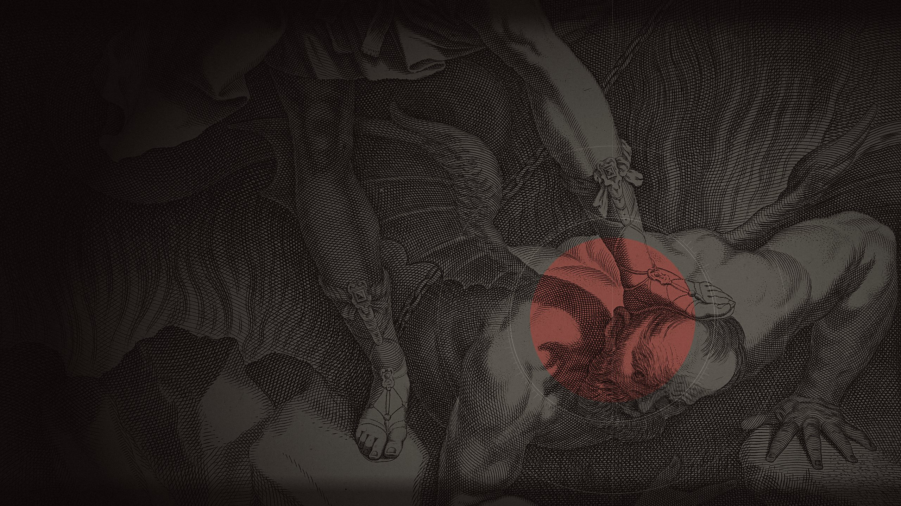
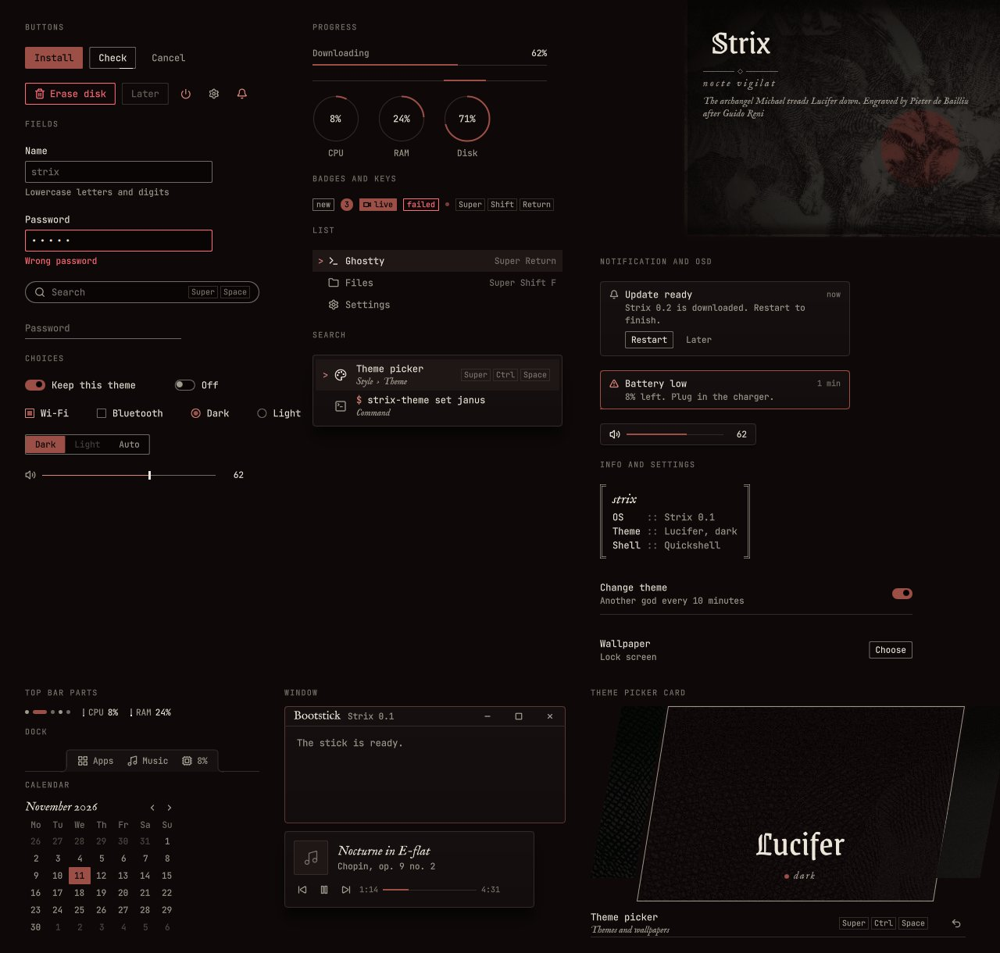

# strix-theme-lucifer

A theme for Strix, outside the eight Roman gods: Lucifer, the fallen light-bringer under the archangel's foot. Ember as the accent (`#9c4f47` on `#0e0908`), the grounds tinted faintly toward it.





## Picture

Pieter de Bailliu (I) after Guido Reni, The Archangel Michael Tramples Satan, Rome, 1623 to 1660, published by Giovanni Battista de' Rossi. Rijksmuseum RP-P-BI-486, public domain. Cropped to Lucifer's head under Michael's foot and printed in two inks of the theme, with the ember disc, by `tools/pack.py` of StrixUI.

## Use it

- Later, Settings › Themes in Strix: connect this repository by its URL.
- Until then, in `machine.nix`, with a checkout of this repository next to it:

  ```nix
  strix.theme.extraThemes.lucifer = ./strix-theme-lucifer/themes/lucifer;
  strix.theme.default = "lucifer";    # optional: start with it
  ```

  Then `sudo strix-rebuild switch` and `sudo strix-theme set lucifer`.

## Change it

The theme is made from `source.toml`. Change the accent or the crop there, then:

```sh
python3 ../strixui/tools/pack.py .    # ends with FAILS 0
python3 check.py
```

The layout and the rules are those of [strix-theme-template](https://github.com/liviosysctl/strix-theme-template).
